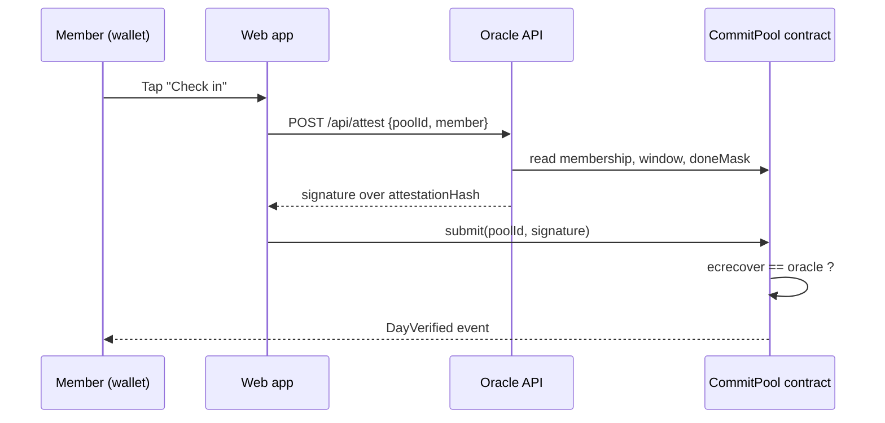
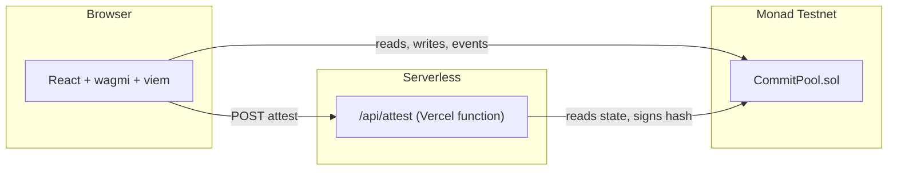

# CommitPool

**Stake money on your habits. Your device proves it. Smart contracts pay the people who follow through.**

CommitPool is a decentralized commitment-contract app built on [Monad](https://monad.xyz). A group of friends each lock the same stake behind a daily goal ("in bed by 23:00"). Every day, each member submits a signed device attestation on-chain inside a time window. Members who complete every day split the stakes of those who didn't. The protocol earns a fee **only** on forfeited stakes; winners never pay.

Built at **Monad Blitz Pune V3** (10 Oct 2026), idea-board track *Commitment contracts & accountability pools*.

| | |
|---|---|
| **Live app** | <https://commit-pool-wutn.vercel.app> |
| **Network** | Monad Testnet (chain ID `10143`) |
| **Contract** | [`0x59747B1A995EF0Cb01CA6A97CE0aaeA38b2474F4`](https://testnet.monadvision.com/address/0x59747B1A995EF0Cb01CA6A97CE0aaeA38b2474F4) |
| **Explorer** | <https://testnet.monadvision.com> |
| **Status** | Hackathon prototype. Testnet only, **not audited** |

---

## Table of contents

- [Why CommitPool](#why-commitpool)
- [How it works](#how-it-works)
- [Architecture](#architecture)
- [Smart contract](#smart-contract)
- [Device oracle API](#device-oracle-api)
- [Frontend](#frontend)
- [Project structure](#project-structure)
- [Getting started](#getting-started)
- [Configuration](#configuration)
- [Testing](#testing)
- [Deployment](#deployment)
- [Security model and limitations](#security-model-and-limitations)
- [Business model](#business-model)
- [Roadmap](#roadmap)
- [Contributing](#contributing)
- [License](#license)

---

## Why CommitPool

Most people who try to fix a habit (sleep schedule, phone use, exercise) quit within weeks. Quitting costs nothing and nobody checks. Existing commitment apps either hold your money and judge you themselves, or rely on friends vouching, which is easy to fake.

CommitPool replaces both with:

- **Escrow with no admin.** Funds sit in the contract. Oracle, treasury and fee are `immutable`; there is no function that lets anyone move member stakes outside the payout rules.
- **Device-verified check-ins.** A signed attestation bound to *(chain, contract, pool, member, day)* is verified on-chain with `ecrecover`. No friend vouching, so no collusion.
- **Public, verifiable history.** Every join, check-in and payout is an on-chain event.
- **A chain fast enough for daily habits.** Many users x many pools x daily check-ins means many small, frequent writes. The app measures and displays each transaction's confirmation time.

## How it works

1. **Create a pool.** Choose a goal, a stake, a number of days (1-30) and up to 20 members. The creator's stake is locked on creation; friends join by staking the same amount until the first check-in window opens.
2. **Check in daily.** Inside each day's window (deadline ± window), the member taps *Check in*. The oracle signs an attestation and the member submits it with `submit(poolId, sig)`.
3. **Settle and claim.** After the last window closes, anyone calls `settle`. Members who verified every day claim their stake plus an equal share of the forfeited stakes (minus the protocol fee).



### Settlement math

Let `n` be members, `w` winners (completed every day), `stake` the per-member stake and `feeBps` the fee.

| Case | Forfeited | Fee | Payout per eligible member |
|---|---|---|---|
| `w = n` (everyone finishes) | 0 | 0 | `stake` |
| `0 < w < n` | `stake * (n - w)` | `forfeited * feeBps / 10000` | `stake + (forfeited - fee) / w` |
| `w = 0` (nobody finishes) | `stake * n` | `pot * feeBps / 10000` | `(pot - fee) / n` (everyone refunded minus fee) |

Integer-division rounding dust is added to the fee, so every wei is accounted for: `paid out + fees == total staked`. This invariant is covered by a fuzz test.

**Example:** three friends stake 0.1 MON, one skips a day. Forfeit = 0.1, fee (10%) = 0.01, each finisher receives `0.1 + 0.045 = 0.145 MON`.

## Architecture



| Component | Responsibility |
|---|---|
| `CommitPool.sol` | Escrow, membership, signature verification, settlement, claims, fee accounting |
| Oracle (`api/`) | Checks membership and window on-chain, signs the attestation hash with the oracle key |
| Frontend (`src/`) | Wallet onboarding, pool creation, check-in, live feed, dashboard and leaderboard |

## Smart contract

`contracts/src/CommitPool.sol` (Solidity 0.8.28, no dependencies, EVM `cancun`).

### Public interface

| Function | Description |
|---|---|
| `createPool(goal, stake, startTime, dayLength, window, numDays, maxMembers)` | Create a pool and lock the creator's stake (`msg.value == stake`) |
| `joinPool(poolId)` | Join by sending exactly `stake`, until `startTime - window` |
| `cancelUnderfilled(poolId)` | Cancel a pool that has fewer than 2 members after the join deadline; members can claim a full refund |
| `submit(poolId, sig)` | Submit today's oracle attestation inside the open window |
| `settle(poolId)` | Compute winners and payouts after the final window (callable by anyone, once) |
| `claim(poolId)` | Pull your payout or refund |
| `withdrawFees()` | Push accrued fees to the fixed treasury (callable by anyone) |
| `openDay`, `deadlineOf`, `endTime`, `joinDeadline`, `attestationHash`, `getMembers` | Views |

### Parameters and limits

| Constant | Value |
|---|---|
| `MIN_MEMBERS` / `MAX_MEMBERS` | 2 / 20 |
| `MAX_DAYS` | 30 |
| `MIN_DAY_LENGTH` | 60 s |
| `MAX_FEE_BPS` | 2000 (20%) |
| Goal length | 1-80 bytes |
| Window | `0 < window` and `window * 2 < dayLength` (windows never overlap) |

### Attestation format

The oracle signs, with EIP-191 `personal_sign`, the 32-byte value:

```solidity
keccak256(abi.encode(block.chainid, address(this), poolId, member, day))
```

Binding the chain, contract, pool, member and day prevents cross-chain, cross-contract, cross-user and cross-day replay. Signatures with an upper-half `s` are rejected (malleability).

### Errors

`BadParams`, `WrongStake`, `PoolNotFound`, `JoinClosed`, `PoolFull`, `AlreadyMember`, `NotMember`, `PoolInactive`, `OutsideWindow`, `AlreadyDone`, `BadSignature`, `TooEarly`, `AlreadySettled`, `NotUnderfilled`, `NothingToClaim`, `TransferFailed`.

### Verification

The deployed source is **verified on Sourcify** with a full (creation + runtime) match: <https://repo.sourcify.dev/10143/0x59747B1A995EF0Cb01CA6A97CE0aaeA38b2474F4>. Compiler settings: solc 0.8.28, optimizer on / 200 runs, EVM `cancun`. The reproducible Standard-JSON input is in [`contracts/verify/CommitPool.standard-input.json`](contracts/verify/CommitPool.standard-input.json).

## Device oracle API

`POST /api/attest`

Request body:

```json
{ "poolId": "12", "member": "0xAbC...", "device": { "source": "phone", "at": 1760000000 } }
```

| Status | Meaning |
|---|---|
| `200` | `{ "signature": "0x...", "day": 0, "proof": {...}, "device": {...} }` |
| `400` | Invalid `poolId` or `member` |
| `403` | Address is not a member of the pool |
| `409` | No window is open, or the day is already verified |
| `422` | The member's data for this day does not meet the pool's goal (`error` explains why, `proof` has the numbers) |
| `405` | Method other than `POST` |
| `500` | Oracle not configured, key does not match the contract's `oracle`, or RPC error |

The same core (`api/_oracle.js`) runs as a Vercel serverless function in production and as a Vite dev-server middleware locally.

> **The oracle is a mock.** It verifies on-chain state only; it does not inspect real device data. See [limitations](#security-model-and-limitations).

## Habit proof (simulated data)

Each check-in is backed by the member's own data for that day. The pool page shows a **Your proof** card (steps, sleep, phone use, wake-up routine or study focus, depending on the goal), and the oracle signs only if that data meets the goal.

- **Per person, per day.** Data is deterministic and seeded by `wallet:pool:day`, so each wallet gets its own numbers and a refresh never changes history.
- **Same engine in browser and oracle.** The pure verification engine lives in `src/data/` and is compiled to `api/_data/` by `npm run gen:oracle` so the serverless oracle runs identical logic. A test fails if the generated files go stale.
- **Supported goals:** sleep/bedtime, phone/scrolling, steps/walking, wake-up/morning routine, study/focus. Other goals are signed without a data check.
- **Simulated today.** The numbers are generated and labelled `DEMO DATA · SIMULATED`. A real source (Apple Health, Health Connect, Oura) plugs in by implementing `HabitDataProvider` in `src/data/providers.ts`; the engine, oracle and contract do not change.

## Frontend

React 19 + Vite + TypeScript, wagmi 3 / viem for chain access, TanStack Query for caching. Hash-based routing:

| Route | Page |
|---|---|
| `#/` | Landing page with live pool and ledger |
| `#/start` | Onboarding wizard: wallet, connect, Monad Testnet, faucet funds |
| `#/app` | Dashboard: your pools, open pools, recent pools |
| `#/new` | Create a pledge |
| `#/pool/:id` | Pool page: progress dial, members, check-in/join/settle/claim, QR invite, calendar export |
| `#/leaderboard` | Ranking over the last 30 pools |

Notable behaviour: live event feed with 1 s polling, per-transaction confirmation time, iCalendar (`.ics`) export of check-in windows, and legacy `?pool=ID` link redirects.

## Project structure

```
commit-pool/
├── api/
│   ├── _oracle.js            # Oracle core (shared by Vercel + dev server)
│   ├── _data/                # Generated JS copy of src/data for the oracle
│   └── attest.js             # Vercel serverless handler
├── contracts/
│   ├── src/CommitPool.sol    # The contract
│   ├── test/CommitPool.t.sol # Foundry tests (18, incl. fuzz)
│   ├── script/Deploy.s.sol   # Deployment script
│   ├── scripts/demo-pool.sh  # Pre-runs a full 3-day demo pool
│   ├── verify/               # Standard-JSON input for source verification
│   └── foundry.toml
├── src/                      # React application
│   └── data/                 # Habit records, simulated data, verification engine
├── tests/                    # Node tests for the data layer
├── scripts/gen-oracle-data.mjs
├── public/                   # Static assets
├── PLAYBOOK.md               # Hackathon team playbook
├── .env.example
└── vite.config.ts            # Vite config + dev oracle middleware
```

## Getting started

### Prerequisites

- Node.js 20+ and npm
- [Foundry](https://book.getfoundry.sh/getting-started/installation) (only for contract work)
- A browser wallet such as MetaMask

### Run the app locally

```bash
git clone https://github.com/atharva-glitch10/commit-pool.git
cd commit-pool
npm install
cp .env.example .env.local     # set ORACLE_PRIVATE_KEY
npm run dev                    # http://localhost:5173 (serves /api/attest too)
```

Without `ORACLE_PRIVATE_KEY` the app still reads pools and lets you create/join them, but check-ins return "Oracle not configured".

### Add Monad Testnet to your wallet

| Field | Value |
|---|---|
| RPC URL | `https://testnet-rpc.monad.xyz` |
| Chain ID | `10143` |
| Symbol | `MON` |
| Explorer | `https://testnet.monadvision.com` |

Get test MON from <https://faucet.monad.xyz>.

### Scripts

| Command | Action |
|---|---|
| `npm run dev` | Start the dev server |
| `npm run build` | Type-check and produce a production build in `dist/` |
| `npm run preview` | Serve the production build |
| `npm run lint` | Lint with oxlint |
| `npm test` | Run the data-layer tests (Node test runner) |
| `npm run gen:oracle` | Regenerate `api/_data/` after changing `src/data/` |

### Try a pool end to end

Use the hosted app at <https://commit-pool-wutn.vercel.app> (no setup beyond a wallet and test MON), or run it locally as above.

1. Connect a wallet and switch to Monad Testnet.
2. Open **New pledge**; choose *60-second demo days*, 1-3 days, a small stake, first check-in in 2 minutes; sign.
3. Share the invite link (or QR) and have a second wallet join.
4. When the dial shows the window is open, each member clicks **Check in for day N**.
5. After the last day, anyone clicks **Pay out the pool**; winners click **Claim**.

## Configuration

| Variable | Scope | Required | Description |
|---|---|---|---|
| `ORACLE_PRIVATE_KEY` | Server only | Yes (for check-ins) | Private key of the address passed as `oracle_` at deploy time |
| `VITE_POOL_ADDRESS` | Client + server | No | Contract address; defaults to the deployed testnet contract |
| `VITE_RPC_URL` | Client + server | No | RPC override; defaults to `https://testnet-rpc.monad.xyz` |

`.env.local` is git-ignored. **Never commit the oracle key** and never put real funds in the oracle account.

## Testing

```bash
cd contracts
forge install foundry-rs/forge-std --no-git
forge test -vv
```

The suite has 18 tests, including a fuzz test (256 runs by default) proving money conservation: everything paid out plus fees equals everything staked. It covers:

- Forged, replayed, cross-user and cross-day signatures
- Window edges and out-of-window submissions
- Double submit, double claim and double settle
- Early settlement, under-filled pool cancellation and refunds
- Join rules (stake, capacity, membership, deadline), parameter validation
- Fee cap, zero-address checks and rounding dust

### Demo pool script

`contracts/scripts/demo-pool.sh` pre-runs a complete 3-day pool with three wallets (one misses day 2). Required environment variables are documented at the top of the file.

## Deployment

### Contract

```bash
cd contracts
ORACLE=0x... TREASURY=0x... FEE_BPS=1000 \
forge script script/Deploy.s.sol:Deploy \
  --rpc-url https://testnet-rpc.monad.xyz \
  --private-key $DEPLOYER_KEY --broadcast
```

`ORACLE` is the signer address whose key goes into `ORACLE_PRIVATE_KEY`; `TREASURY` receives fees; `FEE_BPS` is capped at 2000.

### Web app and oracle (Vercel)

1. Import the repository into Vercel (framework auto-detected as Vite).
2. Set `ORACLE_PRIVATE_KEY` and, if you redeployed the contract, `VITE_POOL_ADDRESS`.
3. Deploy. The `api/attest.js` function is picked up automatically.

If `/api/attest` responds "Oracle key does not match contract oracle", the configured key is not the private key of the `oracle` address the contract was deployed with.

## Security model and limitations

**Guarantees enforced by the contract**

- Treasury, oracle and fee are immutable; fee is capped at 20%.
- Stakes can leave only through `claim` (payout or refund) and `withdrawFees` (fees to the fixed treasury).
- State is updated before external calls in `claim` and `withdrawFees`.
- Attestations are bound to chain, contract, pool, member and day, and malleable signatures are rejected.

**Known limitations**

- **The oracle is trusted and mocked.** It signs for any member inside an open window without validating real device data. A production oracle must verify wearable or health-API data (sleep onset, steps) and should be decentralized or attested. A compromised oracle key can forge check-ins for every pool on the contract.
- `/api/attest` has no rate limiting or authentication beyond on-chain membership checks.
- Demo days are compressed (60 s); production would use 24 h days with a ±1 h window.
- The contract has not been audited. **Use on testnet only.**
- Frontend read patterns (per-member state polling) are fine for demos but not optimized for large pool counts; an indexer would be needed at scale.

## Business model

The protocol takes a fee **only on forfeited stakes** (10% at deploy, hard-capped at 20% in code). Winners never pay, and revenue grows with usage and with failure rate: the app earns when money motivates users, paid for by those who did not follow through. Accrued fees are visible live in the app and withdrawable only to the treasury address fixed at deploy.

## Roadmap

- Real data sources: Apple Health, Google Fit, Oura for the device oracle
- Decentralized or multi-signer oracle and per-user device binding
- Native and PWA check-in experience with reminders
- Indexer for pool, member and leaderboard queries
- Third-party audit and mainnet deployment
- B2B wellness-program pools

## Contributing

Issues and pull requests are welcome.

1. Fork the repository and create a feature branch.
2. Make focused changes; add or update tests for contract changes (`forge test`) and make sure `npm run build` and `npm run lint` pass.
3. Open a pull request describing the change and its motivation.

Please report security issues privately to the repository owner rather than in a public issue.

## License

Released under the [MIT License](LICENSE).
